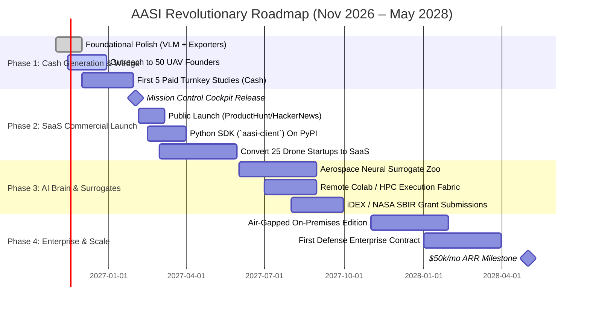

# AASI REVOLUTIONARY MASTER PLAN: THE AUTONOMOUS AEROSPACE CO-SCIENTIST
*The Definitive Architectural, Engineering, Commercial, and Go-to-Market Blueprint for the World's First AI-Native Aerospace Engineering Intelligence Platform*

> **Confidential Founder Master Plan**  
> **Author & Lead:** Aditya Suvvari (Founder, AASI)  
> **Strategic Target:** Build an unprecedented, defensible aerospace software category leader; revolutionize preliminary flight vehicle design; achieve immediate founder cash flow ($10k–$30k/mo) within 90 days scaling to an 8-figure ARR enterprise SaaS.

---

```
  █████╗  █████╗ ███████╗██╗
 ██╔══██╗██╔══██╗██╔════╝██║    AUTONOMOUS AEROSPACE SCIENTIFIC INTELLIGENCE
 ███████║███████║███████╗██║    "The Physics-Native AI Brain for Modern Flight"
 ██╔══██║██╔══██║╚════██║██║
 ██║  ██║██║  ██║███████║██║    Instant Physics • ASME V&V 20 Certification • Autopilot Decks
 ╚═╝  ╚═╝╚═╝  ╚═╝╚══════╝╚═╝
```

---

## 1. Executive Commercial Thesis & The Paradigm Shift

### 1.1 The Multi-Billion Dollar Industry Vacuum
The global aerospace simulation and CAE market is valued at **$4.8 Billion**, surging toward **$72 Billion by 2035** as the aerospace-AI revolution takes hold. Yet, modern aeronautical engineering remains suffocated between two extremes:

1. **The Monopolistic Legacy Giants (Ansys Fluent, Siemens Simcenter STAR-CCM+, Dassault SIMULIA):**
   * **License Costs:** $25,000 to $65,000 per user seat/year.
   * **Compute Footprint:** Requires dedicated HPC clusters and hours-to-days per mesh convergence sweep.
   * **Human Capital Barrier:** Requires dedicated Ph.D. computational aerodynamicists to operate.
2. **The Fragmented 1980s Legacy Heritage Tools (XFOIL, AVL, USAF DATCOM, OpenVSP):**
   * **Fragile Toolchain:** Unmaintained Fortran 77/90 routines, command-line interfaces, and incompatible ASCII output decks.
   * **Engineering Drudgery:** Engineers spend 2 to 3 weeks hand-stitching Python/MATLAB scripts, reformatting coordinates, and manually formatting DATCOM card decks.
   * **Zero Verifiable Quality:** No automated numerical uncertainty quantification (ASME V&V 20) or cryptographic audit trails.

### 1.2 The Rapidly Expanding Unmanned & eVTOL Gold Rush
* Over **150+ funded commercial/defense drone manufacturers in India** and **800+ globally** (surveillance, logistics, loitering munitions, agri-tech, eVTOL urban air mobility).
* **The Agonizing Bottleneck:** 95% of these startups cannot afford $35k Ansys licenses and have lean aero teams (1–3 engineers). Autopilot and flight mechanics leads desperately need aerodynamic coefficients ($C_L, C_D, C_M$), stability derivatives ($C_{L_\alpha}, C_{M_\alpha}, C_{M_q}$), and DATCOM/6-DoF tables to configure PX4, ArduPilot, or Simulink flight controllers.
* **The AASI Revolution:** What takes an engineer **15 days of manual scripting** is delivered by AASI in **under 3 minutes** with mathematical proof of grid convergence.

### 1.3 The Unprecedented North Star: "The Autonomous Aerospace Co-Scientist"
> **"AASI does not just run simulations. AASI is an Autonomous Scientific Mind that designs, solves, verifies, audits, and compiles flight-control-ready digital twins in seconds."**

---

## 2. The Multi-Tier Architecture: Scientific Brain & Compute Fabric

```
┌────────────────────────────────────────────────────────────────────────────────────────┐
│                        AASI 3-TIER REVOLUTIONARY ARCHITECTURE                          │
├──────────────────────────┬─────────────────────────────┬───────────────────────────────┤
│ TIER 1: INSTANT EDGE     │ TIER 2: SCIENTIFIC BRAIN    │ TIER 3: AUTOPILOT COMPILER    │
│ (The High-Speed Wedge)   │ (The Defensible Moat)       │ (The Universal Exporter)      │
├──────────────────────────┼─────────────────────────────┼───────────────────────────────┤
│ • 2D Discrete Vortex     │ • Aerospace Modeling Lang   │ • USAF DATCOM Card Decks      │
│   Panel Solver           │   (AML) Declarative Engine  │ • NASA S/HABP Input Formats   │
│ • Karman-Tsien & Prandtl │ • Kahn Topological DAG      │ • JSBSim 6-DoF XML            │
│   Compressibility        │   Execution Kernel          │   `<fdm_config>` Blocks       │
│ • 3D Vortex Lattice (VLM)│ • ASME V&V 20-2009 / GCI    │ • PX4 & ArduPilot Mixers/     │
│   Trefftz Plane Induced  │   Richardson Extrapolation  │   Param Tuning Tables         │
│ • Helmbold-Keune Finite  │ • Epistemic Validity Guard  │ • MATLAB/Simulink Aerospace   │
│   Wing Aspect Ratio Math │   (Stall & Shock Detection) │   Blockset Lookup Tables      │
│ • Squire-Young Boundary  │ • Automated OpenFOAM Case   │ • Publication-Ready ASME      │
│   Layer Viscous Drag     │   Staging for OOD Regimes   │   V&V 20 2-Page PDF Dossier   │
│ • Execution Time: < 3s   │ • SHA-256 Merkle Provenance │ • Full Merkle Digital Seal    │
└──────────────────────────┴─────────────────────────────┴───────────────────────────────┘
```

### 2.1 The Epistemic Boundary Guard (Solving the AI Hallucination Problem)
Unlike generic LLMs or unconstrained neural surrogates that invent non-physical numbers near stall:
* **Physics Bounds Enforcement:** AASI monitors the flight condition envelope:
  * Mach $M \le 0.70$
  * Reynolds $Re \ge 10^5$
  * Angle of Attack $\alpha \in [-6^\circ, +14^\circ]$
* **Dynamic Warning Badges & Staging:** If an engineer requests $\alpha = 18^\circ$ (flow separation/stall regime) or $M = 0.88$ (transonic shock divergence), the Epistemic Brain:
  1. Flags the result with an immediate UI warning: *"Outside attached potential flow validity envelope"*.
  2. Automatically compiles a high-fidelity SST $k$-$\omega$ RANS **OpenFOAM / SU2 case directory** (mesh dicts, boundary conditions, turbulence models) ready to execute with zero human setup.

### 2.2 Mathematical Rigor: ASME V&V 20 & NASA-STD-7009B
AASI is the only preliminary platform with built-in **automated numerical verification**:
* Runs multi-grid discretizations ($N_1 = 80, N_2 = 160, N_3 = 320$ panels).
* Calculates observed order of accuracy ($p$):
  $$p = \frac{\ln\left(\frac{f_3 - f_2}{f_2 - f_1}\right)}{\ln(r)}$$
* Calculates Grid Convergence Index ($GCI_{fine}$):
  $$GCI_{fine} = \frac{1.25 |\epsilon_{21}|}{r^p - 1}$$
* Embeds this into an executive 2-page verification PDF signed with a cryptographic SHA-256 hash.

---

## 3. Product Suite: What Customers Buy & Pay For

```
┌────────────────────────────────────────────────────────────────────────────────────────┐
│                                 AASI COMMERCIAL SUITE                                  │
├──────────────────────────┬─────────────────────────────┬───────────────────────────────┤
│ DELIVERABLE A:           │ DELIVERABLE B:              │ DELIVERABLE C:                │
│ TURNKEY AERO DATABASE    │ MISSION CONTROL COCKPIT     │ AASI PYTHON SDK & API         │
│ (Cash-Flow Consulting)   │ (Recurring SaaS Cloud)      │ (Automation & MDO)            │
├──────────────────────────┼─────────────────────────────┼───────────────────────────────┤
│ • Full $\alpha, Re, Mach$│ • Apple-Grade macOS/visionOS│ • `pip install aasi-client`   │
│   aerodynamic polar deck │   glassmorphic dashboard    │ • Programmatic sweeps inside  │
│ • Stability derivative   │ • Universal Selig/Lednicer  │   optimization loops          │
│   card ($C_{L_\alpha},   │   airfoil coordinate cleaner│ • Colab / HPC execution bridge│
│   C_{M_\alpha}, C_{M_q}$)│ • Interactive 3D spatial    │ • Tokenized API keys for CI/CD│
│ • Ready-to-run DATCOM,   │   vehicle viewport (ThreeJS)│ • Headless flight envelope    │
│   JSBSim, & PX4 files    │ • Live telemetry sparklines │   generation in pipelines     │
│ • ASME V&V 20 PDF Dossier│ • Team workspaces & projects│ • Webhook completion alerts   │
└──────────────────────────┴─────────────────────────────┴───────────────────────────────┘
```

---

## 4. Quad-Engine Monetization Strategy: The Roadmap to Revenue

AASI deploys an aggressive, self-sustaining financial model designed to generate cash immediately while compounding high-margin annual software recurring revenue (ARR).

```
                            ┌─────────────────────────────────────────┐
                            │           AASI REVENUE ENGINE           │
                            └────────────────────┬────────────────────┘
                                                 │
      ┌────────────────────┬─────────────────────┴────────────────────┬────────────────────┐
      ▼                    ▼                                          ▼                    ▼
┌─────────────┐      ┌─────────────┐                            ┌─────────────┐      ┌─────────────┐
│  ENGINE 1:  │      │  ENGINE 2:  │                            │  ENGINE 3:  │      │  ENGINE 4:  │
│ CASH STUDY  │      │ RECURRING   │                            │  DATA & IP  │      │   GRANTS &  │
│  SERVICES   │      │    SAAS     │                            │ MARKETPLACE │      │  DEFENSE    │
│ (Immediate) │      │ (12-Mo ARR) │                            │ (M6–M18)    │      │ (M3–M18)    │
└─────────────┘      └─────────────┘                            └─────────────┘      └─────────────┘
```

### 4.1 Engine 1: Immediate Cash-Flow Consulting (Months 1–3)
Do not wait 6 months for SaaS traction. Sell immediate turn-around deliverables to funded drone startups:

* **Offer 1: Turnkey Aerodynamic Database Study** — **₹75,000 / $1,000** per airframe.
  * *Deliverable:* Complete polar matrix, stability derivatives, and ASME V&V 20 verification PDF delivered in 48 hours.
  * *Founder Effort:* 15 minutes of compute and verification review.
  * *Margin:* 98%.
* **Offer 2: Full UAV Airframe Envelope + Flight Controller Deck** — **₹1,50,000 / $2,000** per airframe.
  * *Deliverable:* Full wing + tail polar envelope, DATCOM namelist, PX4 parameter tables, and JSBSim XML deck.
* **Target:** Close 5 clients in Month 1–2 = **₹5,00,000 to ₹7,50,000 ($6,000–$10,000)** in non-dilutive founder cash.

### 4.2 Engine 2: Compounding SaaS Subscription Tiers (Months 3–12+)

| Tier | Price (INR / Global) | Target Audience | Features & Computational Quotas |
| :--- | :--- | :--- | :--- |
| **Community** | **Free** | Students, hobbyists, evaluators | 10 sweeps/mo, 2D vortex panel solver, standard CSV export, watermarked verification summary, community forum. |
| **Professional** | **₹3,999/mo**<br>($99/mo) | Solo UAV engineer, aero consultant, startup lead | Unlimited 2D panel sweeps, 3D VLM finite-wing solver, DATCOM / JSBSim / PX4 deck exports, unbranded ASME V&V 20 PDF, email support. |
| **Team / Lab** | **₹24,999/mo**<br>($399/mo) | UAV startups (3–10 engineers), university research labs | 5 user seats, shared project workspace, remote Google Colab & HPC execution bridge, Merkle-DAG audit trail export, priority Slack channel. |
| **Enterprise / Defense**| **₹15,00,000–₹35,00,000/yr**<br>($25,000–$45,000/yr) | Defense suppliers (DRDO/HAL vendors), eVTOL OEMs, aerospace labs | Air-gapped on-premise Docker deployment, custom CFD solver cluster integration, custom aircraft templates, dedicated SLA, formal audit support. |

### 4.3 Engine 3: Pre-Trained Aerodynamic Surrogates & Polar Marketplace (Months 6–18)
* License pre-computed, certified aerodynamic polar libraries for 5,000+ airfoils and common UAV configurations.
* Neural surrogate checkpoints (trained on NASA Common Research Model, ONERA M6, and UIUC databases) licensed to corporate R&D teams for proprietary optimization loops.

### 4.4 Engine 4: Non-Dilutive Government & Defense Grants (Months 3–18)
* **India:** Apply for **iDEX (Innovations for Defence Excellence)** grants (up to ₹1.5 Crore non-dilutive) and TDF (Technology Development Fund) under DRDO for autonomous flight modeling.
* **Global:** Partner with US/EU universities for NASA SBIR/STTR Phase I ($225k) and Phase II ($750k) co-development.

---

## 5. B2B Sales Engine & Founder Acquisition Playbook

### 5.1 The 4-Step "Trojan Horse" Customer Funnel
1. **Target List:** Build a hyper-targeted database of 50 CTOs, Chief Aerodynamicists, and Founders of Indian and global UAV startups (e.g., ideaForge, NewSpace, Asteria, Garuda, Throttle, EndureAir).
2. **Value-First Cold Outreach:** Offer to generate a complete, free aerodynamic database for their active fixed-wing or hybrid VTOL platform in exchange for 15 minutes of candid feedback.
3. **48-Hour Delivery:** Deliver a pristine, branded, publication-quality aerodynamic polar deck, DATCOM cards, and an ASME V&V 20 verification PDF.
4. **The Conversion Call:** Review the results on a 15-minute video call. Show how AASI saved them 80 hours of engineering scripting. Upsell the Team SaaS subscription or paid fleet database contracts.

### 5.2 Word-for-Word Cold Outreach Template (LinkedIn / Email)

> **Subject:** Free aerodynamic polar database & DATCOM export for [Company Name]'s airframe
>
> Dear [First Name],
>
> I saw your team is developing the [UAV Platform / Fixed-Wing Airframe] at [Company Name].
>
> In fixed-wing and hybrid VTOL engineering, generating complete aerodynamic envelopes ($C_L, C_D, C_M$), stability derivatives, and formatting DATCOM decks for PX4/ArduPilot tuning usually takes an aerospace engineer 10 to 15 days of manual scripting.
>
> I founded **AASI (Autonomous Aerospace Scientific Intelligence)** — a platform that automates preliminary aerodynamic sweeps, stability derivatives, and ASME V&V 20 uncertainty estimates in under 3 minutes.
>
> I would love to generate a **complete, verified aerodynamic database for one of your wing/airfoil profiles completely free**, in exchange for 15 minutes of your candid feedback on our report format.
>
> If you send me your airfoil profile name or coordinate file, I will deliver the full polar envelope, stability derivatives, and formatted DATCOM deck within 48 hours.
>
> Best regards,  
> **Aditya Suvvari**  
> Founder, AASI Aerospace | [Demo Link]

---

## 6. Apple-Grade System UI/UX Standards (The "Wow" Experience)

A key reason engineers hate existing tools (Ansys, OpenMDAO, DATCOM) is their soul-crushing user interfaces. AASI adopts the **Apple Human Interface / visionOS** design philosophy:

* **Atmospheric Palette:** Midnight acrylic background (`#060913`), titanium stroke highlights (`rgba(255,255,255,0.08)`), vibrant telemetry accents (Aero Blue `#38bdf8`, Status Emerald `#34d399`, Signal Amber `#f59e0b`).
* **Tactile Interactions:** Smooth spring physics (`cubic-bezier(0.16, 1, 0.3, 1)`), recessed sliding pill switches, and zero visual clutter.
* **Telemetry Typography:** System San Francisco hierarchy with `tabular-nums` formatting to eliminate character jitter during high-frequency solver iterations.
* **Interactive 3D Spatial Viewport:** WebGL/Three.js CAD viewer with real-time pressure distribution contours ($C_p$ color-coded maps), streamlines, and vehicle wireframe modes.

---

## 7. Phased 18-Month Execution Roadmap



---

## 8. Financial Projections: From First Dollar to $1M ARR

| Milestone | Target Horizon | Primary Revenue Driver | Active Customers | Monthly Revenue (MRR) | Annualized Run Rate (ARR) |
| :--- | :--- | :--- | :--- | :--- | :--- |
| **Stage 1: Founder Cash** | Months 1–3 | Turnkey Aero Studies (5 airframes/mo @ ₹75k–₹1.5L) | 5–8 Startups | ₹4,50,000 ($5,500) | ₹54,00,000 ($65,000) |
| **Stage 2: SaaS Wedge** | Months 4–6 | 30 Pro ($99) + 5 Team ($399) SaaS subscriptions | 35 SaaS Clients | ₹4,10,000 ($5,000) | ₹50,00,000 ($60,000) |
| **Stage 3: Growth Scale** | Months 7–12 | 100 Pro ($99) + 25 Team ($399) + 2 Enterprise | 127 Accounts | ₹18,00,000 ($22,000)| ₹2,16,00,000 ($260,000)|
| **Stage 4: Industry Dominance**| Months 13–24| 250 Pro + 75 Team + 8 Enterprise Defense Licenses | 333 Accounts | ₹68,00,000 ($82,000)| **₹8,16,00,000 ($1,000,000)**|

---

## 9. Immediate 7-Day Founder Action Checklist

1. [ ] **Day 1: Verify Export Pipeline End-to-End** — Run a sweep in AASI for NACA 2412 and verify that DATCOM, JSBSim, PX4, and the ASME V&V 20 PDF export with zero errors.
2. [ ] **Day 2: Build the Top 50 Outreach Spreadsheet** — Research 50 Indian UAV companies (Founders, CTOs, Aerodynamics Leads on LinkedIn).
3. [ ] **Day 3: Deploy Mission Control Cockpit** — Ensure the Next.js / FastAPI platform is live on Vercel and Railway/Hetzner with full HTTPS.
4. [ ] **Day 4: Publish Landmark Demo Video** — Record a 90-second, high-aesthetic screen capture showing an airfoil going from raw coordinates to a verified DATCOM deck and 3D pressure map in 30 seconds.
5. [ ] **Day 5: Launch Cold Outreach Wave 1** — Send Script 1 to the first 20 UAV CTOs offering a free aerodynamic database for their active drone platform.
6. [ ] **Day 6: Deliver First Free Databases** — Turn around the first 2 requests in 24 hours to create immediate customer delight.
7. [ ] **Day 7: Host First Conversion Call** — Walk through the results, demonstrate the hours saved, and close the first paid turnkey project or Team SaaS license.
