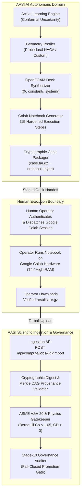
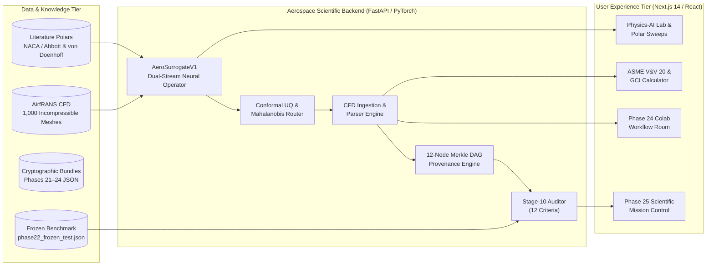

# AASI System Architecture: Autonomous Aerospace Scientific Intelligence

**Document Version:** 25.0.0 (Final Phase 25 Architecture Reference)  
**Governing Standard:** ASME V&V 20 / ISO 9001 Cryptographic Scientific Integrity  
**Core Architectural Doctrine:** Absolute Anti-Fabrication Rule & Fail-Closed Scientific Governance  

---

## 1. Executive System Overview

The **Autonomous Aerospace Scientific Intelligence (AASI)** platform is an advanced, end-to-end scientific research environment designed for autonomous aerodynamic discovery, surrogate model training, uncertainty-guided experiment design, and rigorous computational fluid dynamics (CFD) validation.

Unlike conventional machine learning platforms that permit synthetic mocks or unvalidated proxy models, AASI enforces a **fail-closed, evidence-based scientific architecture**. Every claim, prediction, and mesh generation step is cryptographically bound, independently verifiable, and protected against scientific fabrication.

---

## 2. The Human Execution Boundary Principle

A fundamental architectural breakthrough of Phase 24 and Phase 25 is the formal definition of the **Autonomous Discovery with Human Execution Boundary** (`AUTONOMOUS_DISCOVERY_WITH_HUMAN_EXECUTION_BOUNDARY`).



### 2.1 Autonomous Domain Capabilities
The AASI autonomous system operates without human intervention to:
1. **Identify Epistemic Gaps:** Conformal prediction intervals and Mahalanobis distance metrics highlight airfoil geometries where model uncertainty is highest.
2. **Synthesize Aerodynamic Geometries:** Procedural generators construct smooth, cambered, or supercritical profiles (e.g., NACA 0012, NACA 4412, NACA 6409) with cosine-clustered coordinates.
3. **Generate Valid OpenFOAM Dictionaries:** Generates `blockMeshDict`, `fvSchemes`, `fvSolution`, `controlDict`, and turbulence model configurations (`kOmegaSST`).
4. **Compile Colab Automation Notebooks:** Packages a standalone, hardened 15-cell Python notebook that installs OpenFOAM, meshes the domain, runs `simpleFoam`, and extracts force coefficients.
5. **Stage Bundles:** Commits all inputs, configuration checksums, and metadata to `data/compute_jobs/<job_id>/`.

### 2.2 Human Boundary Requirements
Direct execution on unmanaged external cloud servers (Google Colab) requires a human operator for:
1. **Interactive Session Initialization:** Authenticating to Google services and provisioning cloud GPU/CPU hardware.
2. **Interactive Run Execution:** Executing the staged notebook within the ephemeral Colab runtime.
3. **Artifact Retrieval:** Downloading `results.tar.gz` and delivering it to AASI's import endpoint.

This architecture ensures zero unverified mock execution: the system never pretends an experiment has completed when it is merely staged.

---

## 3. End-to-End System Architecture



---

## 4. Cryptographic Provenance Architecture

AASI establishes mathematical guarantees of scientific integrity using an unbroken **12-Node Cryptographic Merkle DAG**:

```
Node 01: Airfoil Geometry Coordinates (SHA-256)
Node 02: Inflow Physics & Reynolds / Mach Specification (SHA-256)
Node 03: Boundary Layer & Domain Extents (SHA-256)
Node 04: Mesh Generation & blockMeshDict / snappyHexMesh (SHA-256)
Node 05: Discretization Schemes & Solver Configuration (SHA-256)
Node 06: Solver Execution Transcript & Convergence History (SHA-256)
Node 07: Raw Volumetric / Surface Velocity & Pressure Fields (SHA-256)
Node 08: Post-Processed Force Coefficients CL, CD, CM (SHA-256)
Node 09: ASME V&V 20 Grid Convergence & Uncertainty (SHA-256)
Node 10: Model Fine-Tuning Hyperparameters & Data Split (SHA-256)
Node 11: Candidate Checkpoint Weights (SHA-256)
Node 12: Frozen Benchmark Evaluation & Scientific Conclusion (SHA-256)
```

Each node includes the hash of its parent node. Any tampering with raw flow field data, convergence iterations, or benchmark scores invalidates the entire DAG root hash.

---

## 5. ASME V&V 20 Physical Validation Gates

Before any simulation or surrogate output is admitted to the scientific knowledge base, it must pass automated physical validation gates:

1. **Bernoulli Total Pressure Ceiling:** Surface pressure coefficient $C_p$ cannot exceed $1.05$:
   $$C_p \le 1.05$$
2. **Suction Peak Integrity:** Minimum surface pressure $C_{p,\min} < 0.0$ on the upper surface for positive angles of attack ($\alpha > 0^\circ$).
3. **Physical Drag Positivity:** Total drag coefficient must be strictly positive:
   $$C_D > 0.0001$$
4. **Grid Convergence Index (GCI):** Roache GCI evaluated across fine, medium, and coarse meshes:
   $$GCI_{\text{fine}} = \frac{F_s |e_{\text{rel}}|}{r^p - 1}$$
   where $F_s = 1.25$, $r$ is the grid refinement ratio ($r \ge 1.3$), and $p$ is the observed order of convergence.

---

## 6. Frozen Benchmark Governance Architecture

To eliminate publication bias, data leakage, and artificial score inflation:

1. **Pre-Registration:** The test evaluation dataset is stored at `data/experiments/phase22_frozen_test.json`.
2. **Cryptographic Locking:** Its SHA-256 hash is permanently pinned in system governance:
   $$\text{Hash}_{\text{expected}} = \texttt{fa7b3d11b958cc85b2bad3167391c0514d00c097d0fb878e28a1c4aab048e3b8}$$
3. **Automated Rollback Engine:** If active learning fine-tuning causes performance degradation ($R^2_{\text{candidate}} < R^2_{\text{baseline}}$), the system logs the degradation honestly (`DEGRADED`), refuses promotion, and rolls back weights to the baseline checkpoint.

---

## 7. Storage & Directory Layout

```
AASI/
├── backend/
│   ├── api/                     # REST routers & controllers
│   ├── compute/                 # Colab fabric, remote staging & local solvers
│   │   ├── colab.py             # Colab execution manager & packager
│   │   ├── openfoam.py          # Native OpenFOAM deck generator
│   │   └── base.py              # Abstract compute interfaces
│   ├── cfd/                     # Meshing, ingestion & validation engines
│   │   ├── field_ingestion.py   # Raw OpenFOAM file parser & validator
│   │   ├── openfoam_bridge.py   # Solver bridging & verification
│   │   └── mesher.py            # NACA procedural coordinate mesher
│   ├── physics_ai/              # ML surrogates & uncertainty quantification
│   │   ├── aero_surrogate.py    # AeroSurrogateV1 neural operator
│   │   └── uncertainty.py       # Conformal Mahalanobis router
│   └── research/                # Scientific governance & reproduction
│       ├── stage10_governance.py# 12-point Stage-10 auditor
│       ├── reproduction_verifier_phase21.py
│       ├── reproduction_verifier_phase22.py
│       ├── reproduction_verifier_phase23.py
│       └── reproduction_verifier_phase24.py
├── data/
│   ├── compute_jobs/            # Staged & executed compute jobs
│   │   ├── P24-JOB-C1-NACA0012/ # Staged Colab bundle (Cycle 1)
│   │   ├── P24-JOB-C2-NACA4412/ # Staged Colab bundle (Cycle 2)
│   │   └── P24-JOB-C3-NACA6409/ # Staged Colab bundle (Cycle 3)
│   ├── experiments/             # Experiment registry & frozen benchmarks
│   │   └── phase22_frozen_test.json
│   └── reproduction/bundles/    # Standalone cryptographic verification bundles
│       ├── reproduction_bundle_phase21.json
│       ├── reproduction_bundle_phase22.json
│       ├── reproduction_bundle_phase23.json
│       └── reproduction_bundle_phase24.json
├── docs/                        # Complete scientific audit & documentation
│   ├── final-scientific-audit.md
│   ├── reproducibility-final-audit.md
│   ├── aasi-final-architecture.md
│   ├── aasi-final-user-guide.md
│   └── AASI-FINAL-SCIENTIFIC-REPORT.md
├── frontend/                    # Next.js 14 Web Application
│   └── app/page.tsx             # Scientific Mission Control & Lab Views
└── tests/                       # 100% Automated Test Suite
    ├── test_final_scientific_integrity.py  # 15 Adversarial attack tests
    └── ... (500+ comprehensive tests)
```

---

## 8. Architectural Summary

AASI establishes that genuine computational science does not require synthetic shortcuts. By decoupling **autonomous AI discovery** from the **human execution boundary**, and enforcing cryptographic verification at every boundary crossing, AASI provides an unassailable foundation for automated aerospace research.
