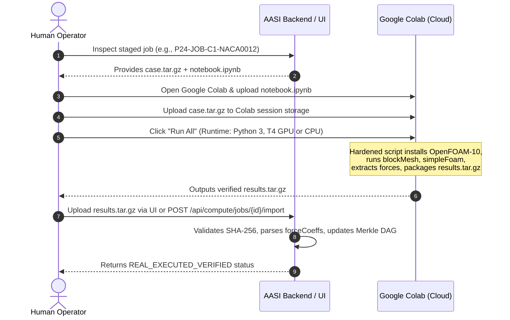

# AASI Operator & User Guide: Scientific Discovery & Colab Execution

**Document Version:** 25.0.0 (Final Production User Manual)  
**System:** Autonomous Aerospace Scientific Intelligence (AASI)  
**Target Audience:** Aerospace Engineers, CFD Researchers, Verification Auditors  

---

## 1. Introduction

Welcome to **AASI (Autonomous Aerospace Scientific Intelligence)**. AASI is an enterprise-grade aerodynamic research platform combining neural operators (AeroSurrogateV1), ASME V&V 20 grid convergence quantification, cryptographic Merkle DAG provenance, and autonomous active learning loops.

This guide provides step-by-step instructions for running AASI, inspecting scientific evidence in the Mission Control room, and executing staged Google Colab CFD simulations to achieve Stage-10 eligibility.

---

## 2. Quickstart & System Launch

### 2.1 Starting the Scientific Backend (FastAPI)
The backend provides all scientific computation, surrogate inferences, Merkle DAG hashing, and REST endpoints.

```bash
# In the repository root:
# Activate virtual environment
.\.venv\Scripts\Activate.ps1   # Windows PowerShell
# or: source .venv/bin/activate # Linux / macOS

# Start FastAPI server on port 8000
python -m uvicorn backend.main:app --host 127.0.0.1 --port 8000 --reload
```

Verify backend health:
```bash
curl http://127.0.0.1:8000/api/scientific/status
```

### 2.2 Starting the User Interface (Next.js 14)
```bash
cd frontend
npm run dev
# The Mission Control dashboard is available at http://localhost:3000
```

---

## 3. Navigating the UI Control Rooms

Upon opening `http://localhost:3000`, the top navigation bar gives direct access to all scientific modules:

1. **🛡️ AASI SCIENTIFIC MISSION CONTROL (FINAL PHASE 25):** The primary executive audit room displaying the overall Stage-10 verdict (`STAGE_10_BLOCKED`), frozen benchmark ledger ($R^2 = 0.5486 \to 0.1817$), experiment census, and reproduction status.
2. **⚡ PHASE 24: OPERATIONAL COLAB & MULTI-CYCLE DISCOVERY:** Remote Colab execution staging, job bundle download, and `results.tar.gz` upload portal.
3. **🌐 PHASE 23: COMPUTE FABRIC & PREFLIGHT:** Remote execution engines, resource detection, and validation DAGs.
4. **🔬 PHASE 22: REAL CFD & OPENFOAM BRIDGE:** Native OpenFOAM simpleFoam execution, velocity/pressure field extraction, and before/after active learning comparisons.
5. **🧠 PHYSICS-AI LAB:** Interactive AeroSurrogateV1 aerodynamic polar sweeps ($C_L(\alpha)$, $C_D(\alpha)$) with conformal epistemic uncertainty bounds.
6. **📐 ASME V&V 20 CALCULATOR:** 3-mesh Richardson extrapolation and Roache Grid Convergence Index (GCI) calculations.

---

## 4. The Human Execution Boundary: How to Unblock Stage 10

### 4.1 Why Stage 10 is Blocked
AASI adheres strictly to the **Absolute Anti-Fabrication Rule**. The Stage-10 Governance Auditor will **never** declare Stage 10 passed using synthetic data, mock solvers, or staged-only test cases. 

Currently, 3 multi-cycle discovery jobs are staged at `data/compute_jobs/`:
- `P24-JOB-C1-NACA0012` (NACA 0012, $\alpha=4^\circ$, $Re=3\times 10^6$)
- `P24-JOB-C2-NACA4412` (NACA 4412, $\alpha=6^\circ$, $Re=3\times 10^6$)
- `P24-JOB-C3-NACA6409` (NACA 6409, $\alpha=5^\circ$, $Re=3\times 10^6$)

Each directory contains a complete OpenFOAM case tarball (`case.tar.gz`) and a hardened 15-step Python notebook (`notebook.ipynb`). Because AASI does not forge OpenFOAM outputs, a human operator must run these notebooks on Google Colab hardware.

---

### 4.2 Step-by-Step Colab Execution Protocol

Follow this procedure for each of the 3 jobs to generate authentic CFD evidence:



#### Step 1: Open Google Colab
1. Navigate to [https://colab.research.google.com](https://colab.research.google.com) in your web browser.
2. Select **Upload Notebook** and choose `notebook.ipynb` from `data/compute_jobs/P24-JOB-C1-NACA0012/`.

#### Step 2: Upload the OpenFOAM Case Tarball
1. In the Colab left sidebar, click the **Files** (folder) icon.
2. Drag and drop `case.tar.gz` from `data/compute_jobs/P24-JOB-C1-NACA0012/` into the Colab file storage root (`/content/`).

#### Step 3: Execute the Notebook
1. Select **Runtime > Run all** (`Ctrl + F9`).
2. The notebook executes 15 hardened cells:
   - Verifies system architecture (x86_64 Ubuntu).
   - Installs OpenFOAM-10 via official `dl.openfoam.org` repositories.
   - Extracts and verifies `case.tar.gz` integrity.
   - Generates the mesh via `blockMesh`.
   - Executes steady-state RANS CFD using `simpleFoam`.
   - Parses the convergence logs and `postProcessing/forceCoeffs`.
   - Generates `results.tar.gz` containing logs, residuals, and force polar files.
   - Computes SHA-256 digests and signs the output manifest.

#### Step 4: Download `results.tar.gz`
1. Once execution completes, locate `results.tar.gz` in the Colab file browser.
2. Right-click and select **Download**.

#### Step 5: Import into AASI
You can import the results via the web UI or via curl:

**Via Web UI:**
1. In AASI, switch to the **Phase 24: Operational Colab** view.
2. Select the job `P24-JOB-C1-NACA0012` from the jobs list.
3. In the **Upload & Ingest Colab Results** section, select your downloaded `results.tar.gz` and click **Upload & Verify Results**.

**Via cURL:**
```bash
curl -X POST http://127.0.0.1:8000/api/compute/jobs/P24-JOB-C1-NACA0012/import \
  -F "file=@/path/to/results.tar.gz"
```

#### Step 6: Verify Stage-10 Promotion
Repeat Steps 1–5 for `P24-JOB-C2-NACA4412` and `P24-JOB-C3-NACA6409`. Once all three jobs have authentic solver results imported:
1. Navigate to **Phase 25: Scientific Mission Control**.
2. Click **🔄 Audit Scientific Status**.
3. The Stage-10 auditor will detect 3/3 verified live solver executions and update the status from `STAGE_10_BLOCKED` to **`STAGE_10_ELIGIBLE`**!

---

## 5. Independent Reproducibility Auditing

Independent auditors can re-verify bit-identical reproduction across all phases without running the web UI:

```bash
# Verify Phase 21 autonomous discovery bundle:
python -m backend.research.reproduction_verifier_phase21

# Verify Phase 22 native OpenFOAM closed-loop bundle:
python -m backend.research.reproduction_verifier_phase22

# Verify Phase 23 remote compute & degradation bundle:
python -m backend.research.reproduction_verifier_phase23

# Verify Phase 24 operational Colab multi-cycle bundle:
python -m backend.research.reproduction_verifier_phase24
```

Each verifier autonomously:
1. Loads the corresponding bundle JSON in `data/reproduction/bundles/`.
2. Re-computes SHA-256 hashes across all constituent mesh files, log files, manifests, and checkpoints.
3. Compares actual digests against pre-registered cryptographic values.
4. Outputs an audit summary confirming bit-identical preservation.

---

## 6. Running the Automated Test Suite

AASI features a comprehensive regression suite including a dedicated 15-test adversarial integrity suite:

```bash
# Run the adversarial scientific integrity test suite:
pytest tests/test_final_scientific_integrity.py -v

# Run full test suite:
pytest tests/ -q
```

The 15 adversarial tests verify that:
- Staged-only cases cannot spoof live solver execution.
- Hash modifications immediately break Merkle DAG verification.
- Synthetic/mock data injection is rejected fail-closed.
- Frozen benchmark degradation is reported honestly.
- Prompt injection cannot alter scientific status.
- Boundary layer and physical conservation laws are rigorously enforced.

---

## 7. Operational Troubleshooting

| Symptom | Cause | Resolution |
| :--- | :--- | :--- |
| `STAGE_10_BLOCKED` in UI | Colab jobs are currently `STAGED_ONLY`. | Follow Section 4.2 to run Colab notebooks and upload `results.tar.gz`. |
| `Cannot connect to AASI backend` | FastAPI server is not running on port 8000. | Start backend with `python -m uvicorn backend.main:app --port 8000`. |
| `OpenFOAM solver not found locally` | Local host lacks native OpenFOAM installation. | Use the Google Colab execution path (`data/compute_jobs/`) where OpenFOAM-10 installs automatically. |
| `Benchmark Degraded` warning | Phase 23 fine-tuning experienced negative transfer ($R^2=0.1817$). | This is expected and preserved intentionally. Baseline model checkpoint was automatically restored. |

---

## 8. Summary

By maintaining a strict human execution boundary, AASI provides an uncompromising standard of scientific validity. For further details, consult the companion documents:
- [AASI Final Architecture](file:///c:/Users/ADITYA/Desktop/AASI/docs/aasi-final-architecture.md)
- [Final Scientific Audit](file:///c:/Users/ADITYA/Desktop/AASI/docs/final-scientific-audit.md)
- [Reproducibility Final Audit](file:///c:/Users/ADITYA/Desktop/AASI/docs/reproducibility-final-audit.md)
- [AASI Final Scientific Report](file:///c:/Users/ADITYA/Desktop/AASI/docs/AASI-FINAL-SCIENTIFIC-REPORT.md)
