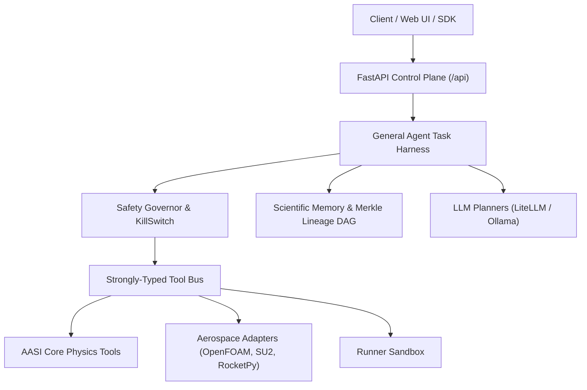

# AASI 2.0 — 01. Current Architecture

## Architectural Overview

AASI is designed as an integrated **Aerospace Scientific Operating System**. It unifies deterministic engineering computation with a fail-closed agent harness and resource governor.

---

## 1. Safety Governor Layer (`backend/governor/`)

- **ResourceMonitor**: Real-time telemetry probing host CPU utilization, available RAM, workspace disk free space, GPU VRAM allocation, and process RSS/threads.
- **ResourceBudget**: Per-task envelopes enforcing limits on CPU %, RAM (GB), disk writing (GB), GPU allocation, and hard timeouts.
- **ExecutionPolicyEngine**: Allowlists for tools and binaries, blocking destructive command patterns (`rm -rf`, `format`, `del /s`), preventing unauthorized external networking and path traversal.
- **KillSwitch**: Atomic emergency halt singleton allowing immediate cooperative cancellation.
- **SafetyGovernor**: Authorization gate computing SHA-256 Merkle hashes for all decisions.

---

## 2. Agent Task Harness (`backend/harness/`)

The core execution loop follows the AASI cognitive lifecycle:
$$\text{QUESTION} \rightarrow \text{PLAN} \rightarrow \text{VALIDATE} \rightarrow \text{EXECUTE} \rightarrow \text{VERIFY} \rightarrow \text{RECONCILE} \rightarrow \text{LEARN} \rightarrow \text{DECIDE} \rightarrow \text{COMPLETE}$$

- **Zero-Hallucination Assertion**: Every claim links directly to validated numerical outputs.
- **Epistemic Classification**: All outputs are categorized as `DATABASE_REAL`, `LIVE_CFD`, `SURROGATE`, `ANALYTICAL`, `DERIVED`, or `STAGED_ONLY`.
- **Physical Invariant Verification**: Enforces boundary conditions ($C_D \ge 0$, lift slope within $2\pi \pm 20\%$).

---

## 3. Physics & Computational Engines (`backend/physics/`)

- **2D Discrete Vortex Panel Solver**: Katz & Plotkin formulation with camber line boundary conditions, Helmbold thickness scaling, Karman-Tsien compressibility, and Schlichting-Squire-Young boundary layer drag.
- **3D Vortex Lattice Wing Solver**: Helmbold-Keune compressible aspect ratio correction and induced drag calculation.
- **Aerodynamic Database Engine**: High-throughput multi-condition polar sweeps and stability derivative extraction ($C_{L\alpha}$, $C_{M\alpha}$, $C_{D,0}$, neutral point).
- **Standards Exporters**: USAF DATCOM standard 80-column fixed-card format, NASA S/HABP tabulated polar format, and 6-DOF simulation CSVs.
