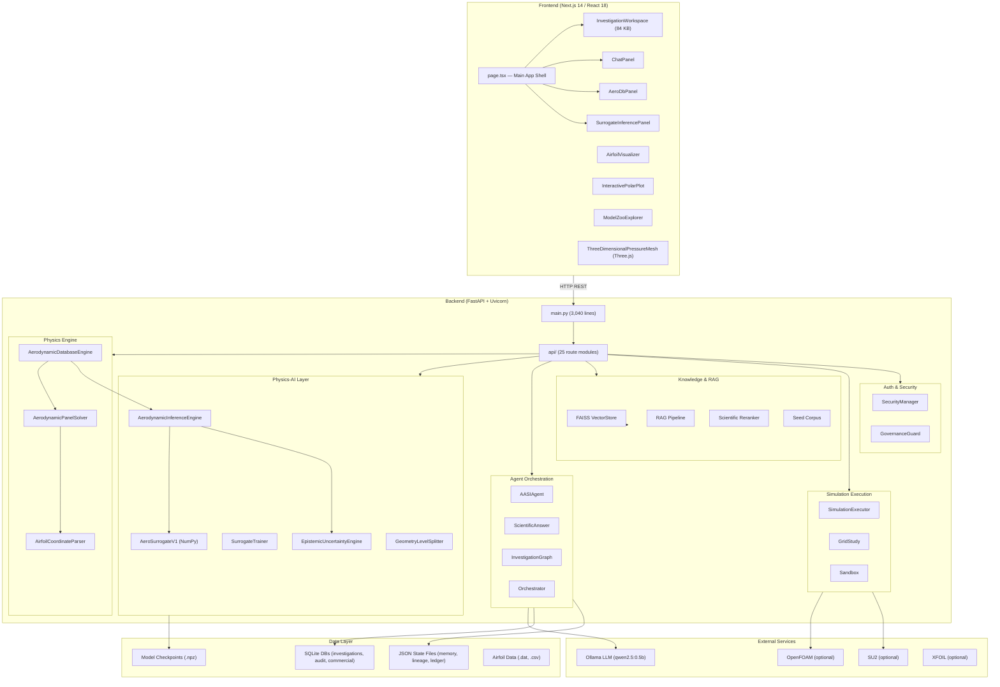

# AASI Architecture & Dataflow — Phase A Audit

**Date:** 2026-10-16
**Commit:** `5b0a5da`
**Method:** Code trace from public entry points through implementations

---

## 1. High-Level Architecture



---

## 2. Key Dataflow Paths

### 2.1 Airfoil Aerodynamic Analysis (Core Workflow)

```
User Input (geometry + conditions)
    │
    ├── POST /api/aerodb/generate
    │       │
    │       ├── 1. AirfoilCoordinateParser.parse_text() or .generate_naca4()
    │       │       → AirfoilGeometry (normalized [N,2] coordinates)
    │       │
    │       ├── 2. AerodynamicPanelSolver.solve() for each (α, Re, M)
    │       │       → CL, CD, CM from vortex panel method
    │       │       → Helmbold thickness correction
    │       │       → Karman-Tsien compressibility correction
    │       │       → Schlichting-Squire-Young viscous drag
    │       │
    │       ├── 3. cfd_catalog.get_benchmark_polar() — database lookup
    │       │       → Known experimental/CFD reference values (if available)
    │       │
    │       ├── 4. AerodynamicInferenceEngine.predict() — surrogate (if checkpoint exists)
    │       │       → ML prediction with OOD assessment (if trained model available)
    │       │
    │       ├── 5. Blended estimate: database > panel method (fallback)
    │       │
    │       ├── 6. StabilityDerivatives extraction (CL_α, CD_0, CM_α, x_ac)
    │       │
    │       └── 7. AeroDatabase response with provenance hash
    │
    └── GET /api/aerodb/{id}/export?format=datcom|shabp|csv|json
            → Formatted output files
```

### 2.2 Surrogate Model Inference

```
Request: POST /api/v1/predict
    │
    ├── 1. AerodynamicInferenceEngine.predict()
    │       │
    │       ├── Check: model.weights_status == "VERIFIED_CHECKPOINT"?
    │       │   └── If NO → raise ModelUnavailableError (fail-closed)
    │       │
    │       ├── 2. Resolve geometry to [64, 2] coordinates
    │       │   └── Known geometries (JSON) or NACA 4-digit generator
    │       │
    │       ├── 3. Normalize conditions: [M, Re, α] via FlowConditionNormalizer
    │       │
    │       ├── 4. Forward pass through AeroSurrogateV1
    │       │   └── Geom Encoder → Cond Encoder → Fusion (residual) → Output
    │       │
    │       ├── 5. Inverse-scale predictions to physical units
    │       │
    │       ├── 6. Evaluate uncertainty via EpistemicUncertaintyEngine
    │       │   └── Mahalanobis distance + nearest-neighbor density → OOD score
    │       │   └── Domain status: IN_DOMAIN | EXTRAPOLATION | OUT_OF_DOMAIN
    │       │
    │       └── 7. Physics validation checks (drag positivity, bounds, symmetry)
    │
    └── Response: AerodynamicPrediction with uncertainty + provenance
```

### 2.3 Agent Chat Flow

```
User Message: POST /api/chat
    │
    ├── AASIAgent.handle_message()
    │   ├── Determine tool intent from LLM (Ollama)
    │   ├── Execute registered tool(s) if applicable
    │   ├── Knowledge retrieval (RAG + FAISS)
    │   └── Scientific resolution hierarchy (8-level)
    │
    └── ChatResponse with:
        ├── response text
        ├── tool_calls[]
        ├── calculations[]
        ├── verification{}
        ├── sources[]
        ├── evidence[]
        ├── assumptions[]
        ├── provenance[]
        └── limitations[]
```

---

## 3. Architectural Observations

### Strengths
1. **Clear separation of physics from ML**: Panel solver is deterministic and independent; surrogate is additive
2. **Fail-closed inference**: Model refuses to predict with unverified/missing checkpoints
3. **Multi-fidelity blending**: Panel + database + surrogate outputs are all tracked separately
4. **Data leakage prevention**: `GeometryLevelSplitter` with geometry-group-aware splits
5. **Epistemic tagging**: All results carry domain status and uncertainty annotations
6. **Provenance tracking**: SHA-256 hashes, Merkle DAG lineage, empirical ledger

### Concerns
1. **Monolithic main.py (3,040 lines)**: Routes are duplicated — defined in both `main.py` and `api/routes_*.py` files, creating maintenance burden and potential inconsistencies
2. **State management via JSON files**: Memory, lineage, and ledger stored as JSON without concurrency protection, migration strategy, or backup/restore
3. **In-memory AeroDB registry**: `_AERO_DATABASES` dict means all generated databases are lost on server restart
4. **No async I/O for computation**: Panel solver and inference run synchronously in the request handler
5. **Authentication enforced inconsistently**: `main.py` route handlers mostly lack auth decorators
6. **Frontend state management**: All state in React `useState` — no persistent state management library
7. **Three.js dependency**: Large WebGL dependency for 3D pressure visualization
8. **No WebSocket/SSE**: No real-time updates for long-running computations

### Missing Boundaries (per Part 4)
| Boundary | Status |
|---|---|
| A. User interface & project management | Partial — no project persistence |
| B. API & authentication | Implemented but auth not enforced on most routes |
| C. Scientific agent & task planning | Implemented via investigation lifecycle |
| D. Deterministic engineering tools | **Implemented** — Panel solver, orbital, rocket tools |
| E. ML inference & surrogate registry | **Implemented** — AeroSurrogateV1 with fail-closed |
| F. Dataset & knowledge services | Implemented — FAISS, RAG, catalogs |
| G. Isolated simulation execution | Partially implemented — sandbox exists, lacks isolation |
| H. Validation & uncertainty | **Implemented** — Physics validator, OOD engine |
| I. Artifact storage & provenance | Partially — CAS storage, Merkle lineage |
| J. Observability & testing | Partially — 946 tests but observability unclear |

---

## 4. Technology Dependencies

### Runtime Dependencies
| Technology | Role | Status |
|---|---|---|
| Python 3.12 | Backend runtime | ✅ Required |
| FastAPI 0.115+ | API framework | ✅ Required |
| NumPy 1.26+ | Numerical computation | ✅ Required |
| SciPy 1.12+ | Scientific computing | ✅ Required |
| SymPy 1.12+ | Symbolic math | ✅ Required |
| Pint 0.23+ | Unit handling | ✅ Required |
| Astropy 6.0+ | Astronomical computations | ✅ Required |
| RocketPy 1.13+ | Rocket propulsion | ✅ Required |
| FAISS-CPU 1.15+ | Vector similarity search | ✅ Required |
| PyPDF 6.18+ | PDF document parsing | ✅ Required |
| Next.js 14+ | Frontend framework | ✅ Required |
| Three.js 0.186+ | 3D visualization | ✅ Frontend only |

### Optional Dependencies
| Technology | Role | Status |
|---|---|---|
| Ollama | Local LLM inference | Optional — agent/chat features |
| OpenFOAM | CFD solver | Optional — detector pattern used |
| SU2 | CFD solver | Optional — not detected on Windows |
| XFOIL | Panel method | Optional — not detected on Windows |
| Redis | Job queuing | In docker-compose but not in requirements.txt |

---

## 5. Security Architecture

### Implemented
- PBKDF2-HMAC-SHA256 password hashing
- HMAC-signed session tokens with expiry
- API key management
- User role system (RESEARCHER, ADMIN, ENTERPRISE)
- CORS configuration
- Secret key management via environment
- Rate limiting configuration (not verified enforcement)

### Gaps
- No CSRF protection
- No request signing
- No WAF or request validation middleware
- File upload lacks size limits and content validation at FastAPI level
- Subprocess execution (OpenFOAM) needs sandboxing review
- JSON state files readable by any process
- Default secret key in docker-compose
- No audit logging of security events (auth failures)
