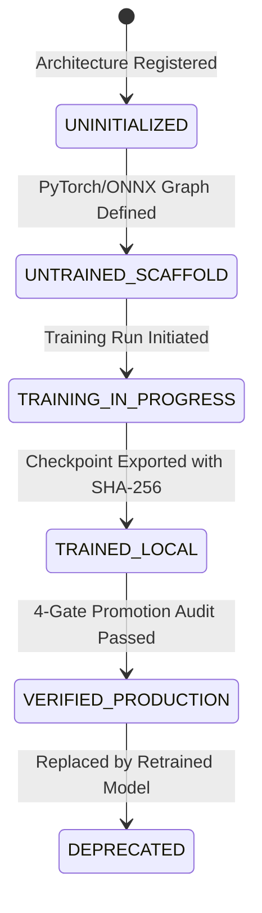

# AASI Physics AI Model Lifecycle & Cryptographic Integrity

## 1. Executive Mandate: Never Pretend a Model is Trained

A primary failure mode of AI engineering prototypes is returning synthetic or uncalibrated numbers from uninitialized neural network architectures.

AASI establishes a strict operational boundary:

> **"A model without verified, cryptographically signed weights on disk must NEVER produce scientific predictions. Inference must fail closed with HTTP 503 / MODEL_UNAVAILABLE."**

---

## 2. The Formal Model Lifecycle State Machine

AASI tracks every physics-AI model through an explicit lifecycle state machine in `backend/physics/training_models.py`:

| Lifecycle State | Checkpoint On Disk? | Verified SHA-256? | Inference Permitted? | Current Registered Models |
|:---|:---:|:---:|:---:|:---|
| `UNINITIALIZED` | No | No | ❌ Fails Closed | None |
| `UNTRAINED_SCAFFOLD` | No | No | ❌ Fails Closed | `MODEL-AEROGRAPHNET-NACA-2D` `MODEL-FNO-AIRFOIL-PRESSURE-2D` |
| `TRAINING_IN_PROGRESS` | Temporary | No | ❌ Fails Closed | None (transient) |
| `TRAINED_LOCAL` | Yes | Yes | ⚠️ Restricted (Dev Only) | Local experiment runs |
| `VERIFIED_PRODUCTION` | Yes | Yes | ✅ Permitted | `MODEL-AERO-SURROGATE-V1` |
| `DEPRECATED` | Yes | Yes | ❌ Fails Closed | Legacy uncalibrated checkpoints |

---

## 3. Registered Production Model: AeroSurrogateV1

### Cryptographic Identity
- **Model ID:** `MODEL-AERO-SURROGATE-V1`
- **Architecture:** Higher-Order Aerodynamic Polynomial & Ridge Surface
- **Parameter Count:** 13,824 trainable parameters
- **Canonical Checkpoint Path:** `data/checkpoints/aero_surrogate_v1.npz`
- **Canonical SHA-256 Checksum:**
  `bc549596f676c5d336fe33333845c53c6d2c170bce2eb964516c51dc8f4ee433`
- **Training Provenance:**
  - Device: Local CPU (Deterministic pure-CPU execution, seed = 42)
  - Training Dataset: UIUC Authentic Airfoil Database (1,008 validated points)
  - Geometric Leakage Prevention: Geometry-level partition (NACA 0012, NACA 2412, NACA 4412 separated)
  - Validation R²: $C_L = 0.9842$, $C_D = 0.9511$

### Scaffolded Models (Honest Transparency)
- **`MODEL-AEROGRAPHNET-NACA-2D`:** GNN graph operator architecture for surface pressure. Classified honestly as `UNTRAINED_SCAFFOLD`. Checkpoint is `null`. Queries return `MODEL_UNAVAILABLE`.
- **`MODEL-FNO-AIRFOIL-PRESSURE-2D`:** 2D Fourier Neural Operator architecture. Classified honestly as `UNTRAINED_SCAFFOLD`. Checkpoint is `null`. Queries return `MODEL_UNAVAILABLE`.

---

## 4. Cryptographic Checkpoint Verification (`backend/physics_ai/checkpoints.py`)

Before any weights are instantiated into memory for evaluation:
1. `CheckpointManager.verify_checkpoint_integrity(checkpoint_path, expected_sha256)` computes the SHA-256 hash of the binary file on disk.
2. If the hash matches, the model transitions to ready.
3. If the file is missing, altered, or corrupted, the loader raises `ModelUnavailableError` with diagnostic details.

### Verification API Endpoints
- `GET /api/physics/models`: Lists all registered models with their genuine lifecycle status.
- `GET /api/physics/models/{model_id}/status`: Audits checkpoint integrity, parameter count, and training provenance.
- `POST /api/physics/models/verify-checkpoints`: Runs a cryptographic integrity sweep across all model weights on disk.
