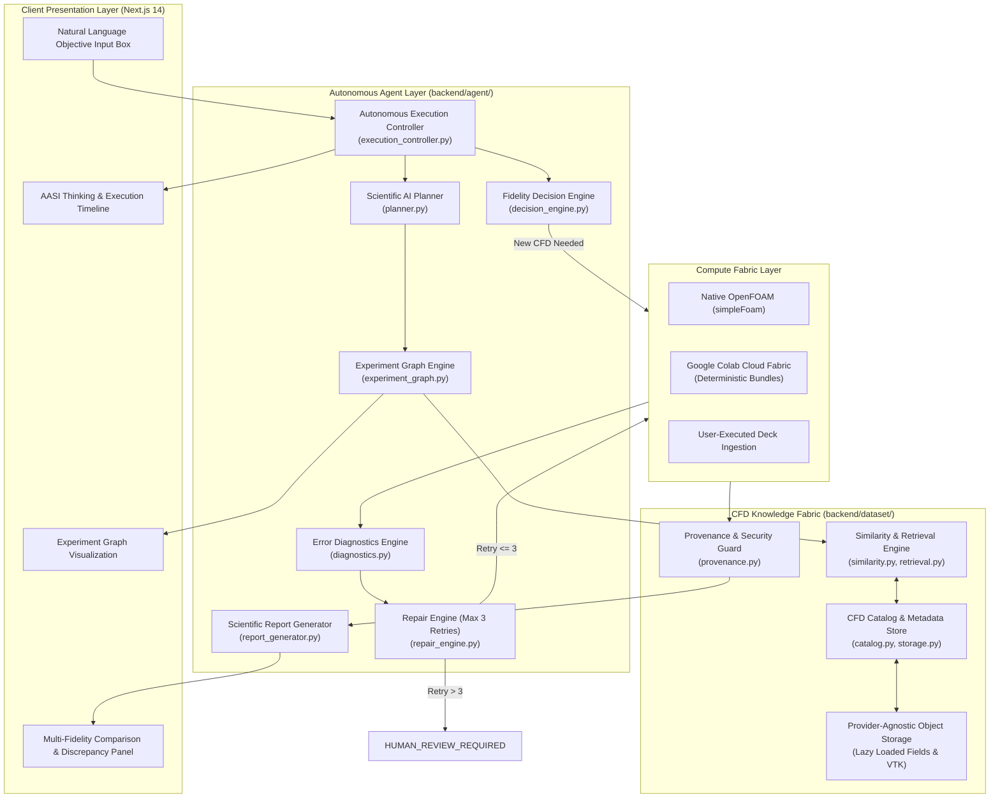

# AASI Phase 25 System Architecture: Autonomous Scientific Execution Platform

**Document Version:** 25.1.0 (Autonomous Architecture Specification)  
**System:** Autonomous Aerospace Scientific Intelligence (AASI)  
**Core Doctrine:** Absolute Anti-Fabrication Rule & Fail-Closed Scientific Governance  

---

## 1. Architectural Mission

The Phase 25 Autonomous Scientific Execution Platform transforms AASI into a production-grade, browser-accessible autonomous aerodynamic research platform.

The system allows aerospace engineers and researchers to express high-level scientific objectives in natural language:
> *"Analyze NACA 4412 at Re=3e6 and alpha=8 degrees and determine whether the current surrogate prediction is trustworthy."*

AASI autonomously:
1. Parses the scientific objective into a deterministic, cryptographically signed specification.
2. Retrieves similar historical CFD and wind tunnel cases from the CFD Knowledge Fabric.
3. Evaluates neural operator surrogate predictions and conformal epistemic uncertainty.
4. Makes a transparent fidelity decision based on empirical distance and uncertainty.
5. Stages valid OpenFOAM cases and packages deterministic Google Colab notebooks.
6. Enforces a strict 10-state progression machine with zero synthetic shortcuts.
7. Diagnoses solver failures across 11 error classes and synthesizes non-mutating repair configurations (capped at `MAX_RETRIES = 3`).
8. Compiles multi-fidelity comparison panels explicitly tracking the origin of every number (`LIVE_CFD`, `DATABASE_REAL`, `SURROGATE`, `ANALYTICAL`).

---

## 2. End-to-End System Topology



---

## 3. Strict CFD Result State Machine

The result lifecycle is strictly non-collapsing. Any verification failure transitions immediately to `FAILED`. A failed simulation cannot transition to success without generating a cryptographically separate repair configuration.

```
PLANNED
  ↓
CASE_GENERATED
  ↓
PREFLIGHT_PASSED
  ↓
BUNDLE_READY
  ↓
EXECUTION_REQUESTED
  ↓
EXECUTING
  ↓
RAW_RESULTS_RECEIVED
  ↓
INTEGRITY_VERIFIED
  ↓
PHYSICAL_VALIDATION
  ↓
SCIENTIFIC_VALIDATION
  ↓
DATABASE_COMMITTED
```

---

## 4. Google Colab Boundary & State Disambiguation

In accordance with strict security standards and terms of service, AASI contains **zero** browser scraping, zero Selenium/Playwright automation of Google Colab, zero cookie extraction, and zero hidden tunnels.

Instead, AASI produces deterministic execution artifacts and tracks four completely distinct Colab states:
- **`COLAB_BUNDLE_READY`:** The case tarball (`case.tar.gz`) and 15-cell Python notebook (`notebook.ipynb`) are staged at `data/compute_jobs/<job_id>/`.
- **`COLAB_EXECUTED`:** Cloud execution has taken place externally.
- **`RESULTS_IMPORTED`:** The resulting `results.tar.gz` archive has been uploaded into AASI.
- **`RESULTS_VERIFIED`:** Archive digests, OpenFOAM version authenticity, residual convergence ($<10^{-4}$), and force logs have passed cryptographic audit.
- **`EXECUTION_UNVERIFIED`:** Declared whenever execution cannot be proven by physical tarball hashes.

---

## 5. CFD Error Diagnostics & Automatic Repair Engine

### 5.1 Diagnostics Engine (`backend/agent/diagnostics.py`)
Classifies errors into 11 formal categories:
1. `MISSING_SOLVER`: Executable not in environment PATH.
2. `MESH_GENERATION_FAILURE`: `blockMesh` topology or vertex error.
3. `MESH_QUALITY_FAILURE`: Non-orthogonality $>70^\circ$, skewness $>4.0$, or negative volume.
4. `INVALID_BOUNDARY_CONDITION`: Patch name or dimensional inconsistency in `0/`.
5. `DIVERGENCE`: Residual explosion $>10.0$ or NaN values.
6. `RESIDUAL_STAGNATION`: Pressure residual oscillating $>10^{-2}$ for $>300$ iterations.
7. `FLOATING_POINT_FAILURE`: SIGFPE / numerical divide-by-zero during matrix solve.
8. `NEGATIVE_PHYSICAL_FIELD`: Non-positive drag ($C_D \le 0$) or negative turbulent kinetic energy.
9. `MISSING_FORCE_COEFFICIENTS`: `postProcessing/forceCoeffs` missing.
10. `INCOMPLETE_RESULT_ARCHIVE`: Corrupted or truncated archive.
11. `RUNTIME_TERMINATION`: Process terminated with non-zero exit code.

### 5.2 Repair Engine (`backend/agent/repair_engine.py`)
Enforces the **Non-Mutating Repair Principle**:
1. The original case remains permanently immutable with its original hash.
2. The repair configuration receives a new cryptographic hash:
   $$\text{Hash}_{\text{candidate}} = \text{SHA-256}(\text{Hash}_{\text{original}} \parallel \text{retry\_number} \parallel \text{modifications})$$
3. A formal justification is committed to the audit trail.
4. The candidate must independently pass preflight checks.
5. Retries are capped at `MAX_RETRIES = 3`. If retries exceed 3, the system transitions to `HUMAN_REVIEW_REQUIRED`.

---

## 6. Real vs AI Visual Disambiguation

Every numerical value in the user interface carries an explicit epistemic badge:
- **`LIVE_CFD`:** Genuinely computed numerical solver solution (`simpleFoam`).
- **`DATABASE_REAL`:** Verified historical experimental polar (Abbott & von Doenhoff, 1959) or peer-reviewed CFD benchmark.
- **`SURROGATE`:** AeroSurrogateV1 neural operator prediction with conformal uncertainty bounds.
- **`ANALYTICAL`:** Potential flow / thin airfoil theory ($2\pi(\alpha - \alpha_0)$).

Numerical discrepancies ($\Delta C_L, \Delta C_D$) between Live CFD, Database CFD, and AI surrogates are computed and displayed explicitly to ensure scientific transparency.
