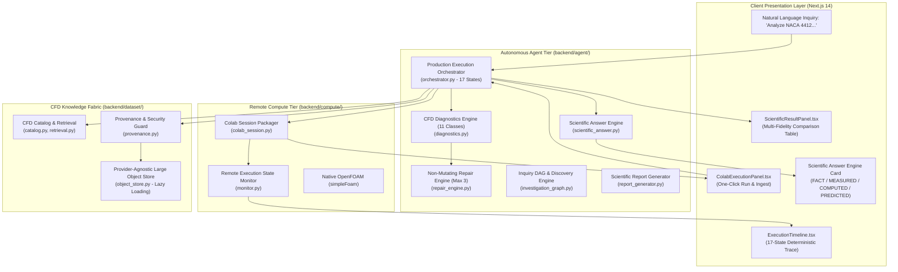

# AASI Phase 26 System Architecture: End-to-End Autonomous Remote CFD Execution

**Document Version:** 26.1.0 (Autonomous Remote Execution Specification)  
**System:** Autonomous Aerospace Scientific Intelligence (AASI)  
**Governing Standard:** ASME V&V 20-2009 / Absolute Anti-Fabrication Rule  

---

## 1. Architectural Mission

Phase 26 transforms AASI into a production-grade, browser-accessible autonomous aerodynamic research platform. Users enter scientific inquiries in natural language, and AASI autonomously coordinates:
- Natural-language objective parsing and deterministic specification derivation;
- Knowledge retrieval across verified CFD datasets;
- Conformal uncertainty evaluation and fidelity determination;
- Automated OpenFOAM case generation and preflight checks;
- Deterministic Google Colab session packaging (manifest, notebook, case tarball);
- Remote execution monitoring with granular milestones;
- Automatic CFD error diagnosis across 11 failure classes with non-mutating repair;
- Cryptographic verification and physical constraint validation;
- Multi-fidelity comparison matrix with explicit epistemic origin tracking;
- Scientific explanation and active learning experiment recommendations.

---

## 2. End-to-End Topology



---

## 3. Formal 17-State Production Machine

The `ProductionOrchestrator` (`backend/agent/orchestrator.py`) enforces strict monotonic state progression:

```
RECEIVED
  ↓
PLANNED
  ↓
KNOWLEDGE_SEARCH
  ↓
FIDELITY_DECISION
  ↓
CASE_GENERATED
  ↓
PREFLIGHT
  ↓
BACKEND_SELECTED
  ↓
JOB_STAGED
  ↓
USER_AUTHORIZATION_REQUIRED
  ↓
REMOTE_EXECUTING
  ↓
RESULTS_AVAILABLE
  ↓
INGESTING
  ↓
VERIFYING
  ↓
SCIENTIFIC_VALIDATION
  ↓
KNOWLEDGE_COMMIT
  ↓
REPORT_GENERATED
  ↓
COMPLETE
```

### Formal Failure States:
- `FAILED_PREFLIGHT`: Triggered if mesh topology, skewness, or boundary dictionaries violate preflight criteria.
- `FAILED_EXECUTION`: Triggered if cloud container terminates or aborts unexpectedly.
- `FAILED_VERIFICATION`: Triggered if archive hashes, force logs, or physical bounds fail audit.
- `HUMAN_REVIEW_REQUIRED`: Triggered when automatic repairs exceed the strict limit of `MAX_RETRIES = 3`.

---

## 4. Google Colab Boundary & One-Click Protocol

In compliance with Google Colab Terms of Service:
- **Zero Browser Automation:** No headless Playwright/Selenium scripts, no automated DOM clicking, no CAPTCHA circumvention, no Google account credential scraping, and no unauthorized background tunnels.
- **Frictionless Handoff:**
  1. AASI synthesizes a deterministic, all-in-one 15-cell Jupyter notebook (`notebook.ipynb`) and case archive (`case.tar.gz`).
  2. The notebook self-installs OpenFOAM-10, extracts the case, runs meshing and `simpleFoam`, checks residuals, and packages signed `results.tar.gz`.
  3. The operator clicks **Runtime > Run All** in Google Colab and uploads `results.tar.gz` back to AASI.
  4. Zero manual terminal commands or OpenFOAM script editing is required by the user.

---

## 5. CFD Error Recovery Engine (11 Classes)

| Failure Class | Signature / Evidence | Deterministic Repair Strategy |
| :--- | :--- | :--- |
| **1. Residual Divergence** | Residual explosion $> 10.0$ or $> 100.0$ | Lower fvSolution relaxation (p: 0.2, U: 0.5) and bound upwind schemes. |
| **2. Floating Point Exception** | SIGFPE or `nan` in residuals | Damped relaxation factors and mesh boundary layer refinement. |
| **3. Mesh Quality Failure** | Skewness $> 4.0$ or non-orthogonality $> 70^\circ$ | Soften hyperbolic boundary layer grading and refine surface cells. |
| **4. Residual Stagnation** | $R_p > 10^{-2}$ for $> 300$ iter and $|\Delta R_p| < 10^{-4}$ | Tighten GAMG tolerances and increase max iterations to 3000. |
| **5. Courant Instability** | Courant number max $> 5.0$ | Reduce deltaT by 50% and clamp maxCo to 0.8. |
| **6. Boundary Mismatch** | Patch name mismatch or dimension error | Harmonize patch names in 0/ with polyMesh/boundary. |
| **7. Missing Field** | Cannot find file `0/nut` or `0/k` | Synthesize standard wall-function boundary fields. |
| **8. Missing Solver** | Solver executable not in PATH | Reroute execution to remote Google Colab container. |
| **9. Time-Step Instability** | deltaT reduced below numerical limit | Lock deltaT to fixed conservative value. |
| **10. Linear Solver Failure** | GAMG failed to converge in max iterations | Switch pressure solver to PCG with DIC preconditioner and increase maxIter. |
| **11. Turbulence Instability** | Negative $k$ or $\omega$ bounded by limiter | Damp $k$ and $\omega$ relaxation to 0.4 and clamp inlet $k$. |

### Non-Mutating Candidate Rule:
- Original cases are never modified in-place.
- Each repair receives a unique SHA-256 candidate digest:
  $$\text{Hash}_{\text{candidate}} = \text{SHA-256}\Big(\text{Hash}_{\text{original}} \parallel r \parallel \text{JSON}(\text{modifications})\Big)$$
- Retries are hard-capped at $r \le 3$. Exceeding 3 retries transitions to `HUMAN_REVIEW_REQUIRED`.

---

## 6. Strict 8 Epistemic Classes & Large Object Storage

AASI distinguishes 8 epistemic classes in `backend/dataset/object_store.py`:
1. `REAL_EXECUTED_VERIFIED`: Genuine OpenFOAM run verified against solver logs and convergence.
2. `USER_EXECUTED_VERIFIED`: External user CFD deck ingested and verified.
3. `DATABASE_REAL`: Historical wind tunnel experimental benchmark (Abbott & von Doenhoff, 1959).
4. `SURROGATE`: AeroSurrogateV1 neural operator prediction with conformal uncertainty.
5. `ANALYTICAL`: Thin airfoil potential flow theory ($C_L = 2\pi(\alpha - \alpha_0)$).
6. `SYNTHETIC_FIXTURE`: Unit test fixtures strictly isolated from production.
7. `STAGED_ONLY`: Case decks generated and packaged, awaiting cloud execution.
8. `NOT_EXECUTED`: Candidate points in discovery pool not yet run.

Large field data (VTK files, pressure/velocity arrays, mesh databases, tarballs) are managed via `LargeObjectStore` with lazy retrieval on demand.
