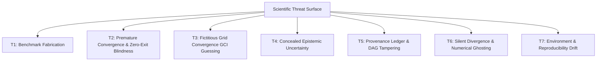

# AASI Scientific Security Threat Model: Epistemic Integrity & Independent Reproducibility

## 1. Executive Summary & Security Philosophy
Computational aerospace engineering systems are increasingly subject to AI-assisted decision making. Unlike standard software threat models that focus predominantly on network intrusion, SQL injection, and authorization bypass, an **autonomous scientific intelligence platform** faces a uniquely insidious class of vulnerabilities: **epistemic corruption, simulated reality hallucination, and unearned scientific claims**.

AASI enforces an uncompromising security posture:
> **"A calculation that cannot be independently reproduced is not scientific truth. An AI prediction presented without quantified epistemic uncertainty is a scientific hazard."**

This document establishes the formal **Scientific Security Threat Model** for AASI, detailing attack vectors, impact profiles, mitigation architectures, and automated invariant verification gates.

---

## 2. Epistemic Threat Classification & Attack Vectors



### Threat T1: Fabricated or Hallucinated Scientific Benchmarks
- **Threat Vector**: An AI assistant or surrogate model generates synthetic aerodynamic curves (e.g. lift, drag, pitching moment) and misrepresents them as authoritative experimental wind-tunnel measurements or direct CFD simulations.
- **Impact**: Extreme. Downstream aerodynamic design based on synthetic data can lead to structural overload, aerodynamic flutter, or unexpected post-stall loss of control.
- **AASI Defense**:
  - Strict Epistemic Status taxonomy (`REAL`, `DERIVED`, `REFERENCED`, `SURROGATE`, `USER_EXECUTED`, `DEMONSTRATION`).
  - Mandatory SHA-256 content hashes for all raw experimental datasets (e.g., UIUC Selig standard, NASA TM-4083 digitized tables).
  - Explicit license, authoritative author attribution, and publication report references.
  - Any simulated mock path is strictly isolated under `DEMONSTRATION` and prohibited from contributing to `EvidenceLedger` scientific conclusion promotion.

---

### Threat T2: Premature Convergence & Process Exit Code Blindness
- **Threat Vector**: A computational CFD wrapper checks only whether `simpleFoam` or another external solver exited with status code `0`. Because standard solvers frequently exit code `0` even when residuals remain stalled at $10^{-2}$ or force coefficients are violently oscillating, treating process termination as physical convergence produces invalid aerodynamic data.
- **Impact**: High. Unconverged flow fields predict artificially low drag or unphysical separation zones.
- **AASI Defense**:
  - `backend/simulation/executor.py` decouples process exit code from physical convergence.
  - Convergence requires:
    1. Residual reduction: maximum residual of $U_x, U_y, p \le 1.0 \times 10^{-4}$.
    2. Force stabilization: standard deviation of $C_L$ and $C_D$ over the last 50 iterations $\le 1.0 \times 10^{-3}$.
    3. Mass continuity errors bounded without unbounded accumulation.
    4. Absence of NaN or unbounded divergence.
  - Solvers exiting code `0` without meeting these criteria are flagged as `UNCONVERGED`.

---

### Threat T3: Fictitious Grid Convergence (GCI Guessing on Non-Monotonic Grids)
- **Threat Vector**: When performing mesh refinement studies, solvers may exhibit oscillatory convergence ($R < 0$) or divergence ($R \ge 1$). Systems that heuristically interpolate or "guess" a Grid Convergence Index (GCI) mask numerical discretization errors.
- **Impact**: High. Discretization errors can dwarf physical aerodynamic effects, especially in boundary-layer separation zones.
- **AASI Defense**:
  - `backend/simulation/grid_study.py` implements the strict ASME V&V 20-2009 standard.
  - Calculates observed order of convergence $p$ using fixed-point iteration on refinement ratios $r_{21}, r_{32}$.
  - Verifies monotonicity condition $0 < R < 1$ where $R = \frac{\phi_1 - \phi_2}{\phi_2 - \phi_3}$.
  - If $R < 0$, strictly returns `OSCILLATORY_CONVERGENCE` with `gci_fine = None`.
  - If $R \ge 1$, strictly returns `DIVERGENT_GRID` with `gci_fine = None`.
  - Fails closed: refuses to guess or report extrapolated values unless mathematical monotonicity is proven.

---

### Threat T4: Concealed Epistemic Uncertainty in Non-Linear Regimes
- **Threat Vector**: Presenting point predictions from neural networks or low-order surrogates across flight regimes without uncertainty bars, particularly in separated, transonic, or post-stall regions where turbulence models (e.g., $k$-$\omega$ SST) have high epistemic variance.
- **Impact**: Critical. Flight envelope expansion without bounded confidence intervals risks catastrophic flight hazards.
- **AASI Defense**:
  - 5-tier GUM (Guide to the Expression of Uncertainty in Measurement) uncertainty framework in `backend/physics/uncertainty_model.py`:
    1. **Input Uncertainty**: flight condition tolerances ($\Delta M, \Delta \alpha, \Delta Re$).
    2. **Numerical Uncertainty**: ASME V&V 20 fine GCI + iterative convergence residuals.
    3. **Model Uncertainty**: surrogate epistemic distance + turbulence closure discrepancy ($\Delta C_L = 0.065$ for $\alpha \ge 12^\circ$).
    4. **Measurement Uncertainty**: NASA LTPT balance accuracy ($\pm 0.005$ on $C_L$).
    5. **Combined Expanded Uncertainty**: $U_{95} = 1.96 \cdot u_c$ coverage interval.
  - Scientific promotion gate requires regimes to be explicitly segmented (Linear: High Confidence, Pre-Stall: Moderate Confidence, Stall: High Epistemic Uncertainty).

---

### Threat T5: Provenance Ledger & DAG Tampering
- **Threat Vector**: Malicious or accidental alteration of evidence records, insertion of cyclic dependencies, disconnection of data sources (orphan records), or promotion of a conclusion without an unbroken path to verified physical benchmarks.
- **Impact**: High. Compromises scientific auditability and reproducibility.
- **AASI Defense**:
  - `backend/research/evidence_ledger.py` implements `ledger.verify_integrity()`:
    1. **DAG Cycle Detection**: Depth-first search (DFS) traversal detecting cyclic dependencies.
    2. **Orphan Record Audit**: Reverse graph traversal verifying that every record connects to the root hypothesis or terminal conclusion.
    3. **Broken Parent Links**: Ensures every parent identifier exists within the ledger.
    4. **Duplicate Identifier Guard**: Rejects collision of record IDs.
    5. **Merkle Root Verification**: Computes cryptographic root hash across the entire topological sequence.

---

### Threat T6: Silent Divergence & Numerical Ghosting
- **Threat Vector**: Floating-point NaN, Inf, or unbounded growth in velocity/pressure fields occurring deep inside CFD iterations, masked by solver output formatting or log truncation.
- **Impact**: High. Corrupts downstream data pipelines with NaN propagation or silent numerical ghosts.
- **AASI Defense**:
  - Continuous regex scanning across all residual lines and force coefficient files.
  - Immediate `DIVERGENCE_DETECTED` trigger if any value exceeds $10^4$ or contains `NaN`/`Inf`.
  - Execution abort and explicit failure logging.

---

### Threat T7: Environment & Reproducibility Drift
- **Threat Vector**: Differences between the research generation environment (OS, compiler, Python version, package hashes) and independent peer replication environments causing reproducibility failures.
- **Impact**: Medium to High. Inability of independent peer reviewers to replicate findings.
- **AASI Defense**:
  - `ReproducibilityBundleExporter` generates standard self-contained bundles:
    - 14 canonical descriptor JSON files.
    - Full SHA-256 manifest (`hashes.sha256`).
    - Raw geometry Seling standard `.dat`.
    - Executable shell scripts (`run.sh`).
    - Machine-readable reproduction contract (`reproduce.json`).
    - Human-readable reproduction instructions (`REPRODUCE.md`).
  - Automated `ReproducibilityVerifier` performs independent 8-point audits with SHA-256 bit-for-bit checksums.

---

## 3. Epistemic Status Transition Security Policy

```
[UNVERIFIED / PROPOSED]
       │
       ▼
[QUESTION_VALIDATED] ──(Input Hash SHA-256)──► [EVIDENCE_COLLECTED]
                                                      │
                                                      ▼
[COMPUTATION_COMPLETED] ◄──(Geometry Hash)── [DATASET_VALIDATED]
       │
       ▼
[VALIDATION_COMPLETED] ──(GUM 5-Tier)──► [UNCERTAINTY_ASSESSED]
                                                      │
                                                      ▼
[COMPLETED] ◄──(ReproducibilityVerifier)── [CONCLUSION_GENERATED]
```

Under this security policy, no conclusion may achieve `MULTI_SOURCE_VALIDATED` or `RESEARCH_GRADE` status unless:
1. Every supporting node in the evidence ledger has an unbroken cryptographic provenance trail.
2. Monotonic grid convergence or clean ASME V&V 20 fail-closed status is documented.
3. 5-tier GUM uncertainty intervals ($U_{95}$) are attached.
4. Independent automated verification succeeds with zero SHA-256 mismatches.
